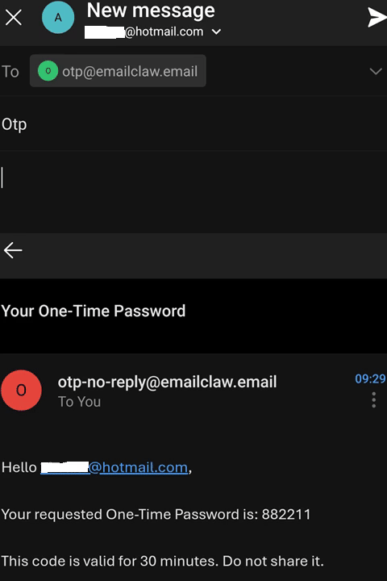
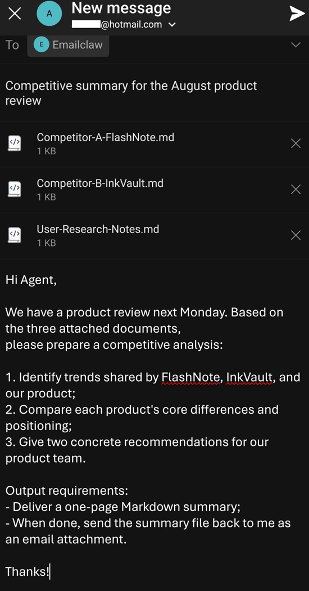

<p align="center">
  
</p>

<h1 align="center">Emailclaw</h1>

<p align="center">
  <strong>Email in. Work out. The Ultimate Java-Powered AI Agent for Email Lovers!</strong><br />
  以电子邮件为默认交互入口、以主题为项目边界的本地优先 AI Agent。
</p>

<p align="center">
  <a href="https://emailclaw.email/">Official Website (emailclaw.email)</a> ·
  <a href="./docs/Emailclaw-User-Manual-zh.md">安装与使用</a> ·
  <a href="./README.md">English</a>
</p>

## 看它如何工作：从收件箱到自动化

<p align="center">
  
</p>

只需 5 步，轻松创建任务和自动化调度：
1. **获取验证码：** 发送邮件到 `otp@emailclaw.email` 以获取一次性密码（OTP）。
2. **配置系统：** 在 Emailclaw 设置中输入注册邮箱和 OTP。验证成功后，你将获得一个 Agent 专属邮箱（如 `YOUR-AGENT@emailclaw.email`）。
3. **发送任务：** 向专属邮箱发送你的任务（例如："Please tell me the latest global AI technology news"）。
4. **确认执行：** 收到带有 TaskId 的回信后，直接回复该邮件以启动任务，你将收到执行结果。
5. **设置定时：** 再次回复该邮件要求转为定时任务（例如："Please convert this task into a scheduled task, with the runtime hours set to 7, 12, 17 and 23"）。Emailclaw 将自动为你按时运行！

## 严格的隔离机制：Email In, Work Out

<p align="center">
  
</p>

当邮件通道调用时，显式传入刚刚创建的 `projectId`，强制让 Agent 沙盒与各类文件读写 Tool 将工作目录绑定到这个专属的 `projects/<projectId>` 目录上
1. **提交任务：** 用户发新标题的邮件时加了三个 md 文件作为邮件附件，要求 Agent 分析后生成 md 文件作为附件回复。
2. **项目初始化：** Emailclaw 按照 "New subject, new project" 原则创建新项目，用户回复确认。
3. **Agent 执行：** Agent 分析用户的资料后生成用户要求的 md 文件，并作为邮件附件回复给用户。
4. **物理隔离：** 查看文件系统，在物理上看，用户的三个文件和 Agent 生成的一个文件都保存在 project 专属的目录里，和其他项目在物理上完全隔离。

## 为什么是 Emailclaw？

Emailclaw 把 AI Agent 放进每个人都熟悉的邮箱。它不是把电子邮件当成又一个聊天渠道，而是把邮件主题视为一项工作的明确边界：

> **New Subject, New Project.**

一封没有有效 TaskId 的新主题邮件会创建独立任务会话、项目记录和项目目录。系统回信附上 TaskId；用户直接回复这封邮件后，后续消息、附件与 Agent 工作都留在同一任务中。要开始另一件事，只需写一个新主题。

这让 Emailclaw 特别适合 email lovers，以及需要在研究、写作、代码审阅、报表、客户回复和自动化工作之间保持清晰上下文边界的人。

## 核心特性

- **Email-first**：使用 IMAP 收取任务、SMTP 回传结果。无需学习或迁移到新的即时聊天应用。
- **主题级项目隔离**：New Subject, New Project；TaskId 绑定邮件线程、会话历史和项目目录。
- **本地优先**：配置、项目、会话、附件、工作区、日志与插件保存在你控制的机器上。
- **受控的 Agent 行动**：模型、工具、Skills、MCP、定时任务和插件可组合使用；高风险工具调用可通过邮件四位确认码审批。
- **极客与终端交互：Rich Terminal Experience (JLine 4.5.0 CLI)**：内置工业级命令行交互式 REPL 与非交互式批处理运行引擎（`emailclaw cli`、`emailclaw run "<prompt>"`）。基于 JLine 4.5.0 构建，支持 Token/思考链/工具调用高清流式卡片渲染、斜杠命令系统（`/session`、`/agent`、`/model`、`/skills`、`/plan` 等）、Tab 智能补全、实时语法高亮、持久化历史记录（`~/emailclaw/.cli-history`）、JUL 运行时日志重定向隔离以及人机协同（HITL）交互式安全审批门禁。
- **适合长期运行**：支持 Linux 无界面服务模式、开机启动、Cron 自动化和日志排障。
- **连接顶级 AI CLI 的天然桥梁**：以所有人每天都在使用的电子邮件为桥梁（无需安装任何额外 App），连接并无缝调度 Google Antigravity CLI (`agy`)、Claude Code CLI (`claude`)、OpenAI Codex CLI (`codex`) 与 OpenCode CLI (`opencode`) 等前沿编程工具。
- **Hermes 闭环自学习与技能自演进**：告别静态固化的配置文件，构建“经验反思沉淀 → 技能草稿创建（安全扫描门禁）→ 运行时遥测 → 实时热修补 → 后台 Curator 归档与 LLM 伞状合并”完整自演进闭环；结合 SQLite FTS5（含 CJK 双字切分）跨会话全文检索与 Honcho 辩证用户建模，随使用愈发精准。
- **可扩展**：基于 Java SPI 与外部 JAR 插件；可扩展工具、Provider、钩子、MCP、界面和渠道。
- **基于 AgentScope Java**：使用 AgentScope Java 2.0 的 Agent、模型、事件、工具、权限与 Harness 能力。

## 它如何工作

```text
你的邮箱
  │  发送一封新主题邮件
  ▼
Emailclaw Channel
  │  创建会话 + 项目，回信附 TaskId
  ▼
回复同一封邮件（保留 TaskId）
  │
  ▼
Agent 在隔离工作区中推理、调用受控工具、生成结果
  │
  ▼
结果、附件或审批请求回到原邮件线程
```

首封新主题邮件用于建立稳定的任务边界；它不会立刻执行模型调用。请回复 Emailclaw 回信，并保留主题末尾完整的 TaskId。

## 快速开始

### 1. 安装发布包

发布流程会为以下平台构建桌面安装包，请到 <https://github.com/emailclaw/emailclaw/releases/> 下载最新版本安装包：

| 平台 | 资产类型 | 安装方式 |
| --- | --- | --- |
| Windows | `.exe` | 下载后双击安装，按安装向导完成操作 |
| macOS | `.dmg` | 打开磁盘映像，将应用拖入“应用程序”目录 |
| Linux 便携部署 | `.tar.gz` | 执行 `mkdir -p ~/.local/ && cd ~/.local/ && wget https://github.com/emailclaw/emailclaw/releases/latest/download/emailclaw-linux-latest.tar.gz && tar -xzf emailclaw-linux-latest.tar.gz -C ~/.local/ --no-same-owner`；启动 **Emailclaw** 运行 `~/.local/emailclaw/bin/emailclaw` |
| Debian/Ubuntu Linux | `.deb` | 执行 `wget https://github.com/emailclaw/emailclaw/releases/latest/download/emailclaw-linux-latest.deb && sudo apt install ./emailclaw-linux-latest.deb`；从应用菜单启动 **Emailclaw**，或运行  `/opt/emailclaw/bin/emailclaw` |

#### 原生 Linux 自动化安装脚本与基于 Docker Compose 的工业级容器化部署

* **原生 Linux 自动化安装脚本**（自动检测 amd64/arm64 架构、安装依赖、注册开机自启）：
  ```bash
  # 桌面图形界面模式：安装后立即启动桌面应用
  curl -fsSL https://raw.githubusercontent.com/emailclaw/emailclaw/main/deploy/install.sh | bash

  # 服务器无头服务模式：安装并以 systemd 后台服务运行（--service）
  curl -fsSL https://raw.githubusercontent.com/emailclaw/emailclaw/main/deploy/install.sh | bash -s -- --service
  ```

* **基于 Docker Compose 的工业级容器化部署**（适合 24/7 云服务器或 VPS，基于通用 Ubuntu 26.04，无需外部 JDK，内置 Google Chrome 与中文字体，非 root 最小权限运行）：
  ```bash
  mkdir -p emailclaw-docker && cd emailclaw-docker
  curl -O https://raw.githubusercontent.com/emailclaw/emailclaw/main/deploy/Dockerfile
  curl -O https://raw.githubusercontent.com/emailclaw/emailclaw/main/deploy/docker-compose.yml
  curl -O https://raw.githubusercontent.com/emailclaw/emailclaw/main/deploy/.env.example
  cp .env.example .env
  docker compose up -d
  ```
  详细部署指南请见 [deploy 部署指南](./deploy/README-zh.md)。

### 2. 配置模型与 Agent

启动桌面应用后：

1. 在 **Providers** 添加模型服务的 Base URL、API Key 和模型 ID。
2. 在 **Agents** 创建或选择一个默认 Agent，并选择模型与系统提示词。
3. 建议先在本地聊天中发一条简单消息，确认模型凭据和网络可用。

### 3. 配置 Emailclaw Channel


点击 ****Emailclaw Settings**，打开配置页面。你可以使用自己的邮箱，或在系统提供邮箱功能可用且你已获授权时按界面指引注册。

### 3.1 使用自己的邮箱

填写以下项目：

- **Email Address**：Emailclaw 用来收发任务的邮箱地址。
- **Email Password**：应用专用密码、授权码或该邮箱服务要求的凭据。
- **IMAP Host / Port / SSL / STARTTLS**：收信服务器参数。
- **SMTP Host / Port / SSL / STARTTLS**：发信服务器参数。
- **Poll Interval**：轮询收件箱间隔，最小 5 秒，默认 30 秒。
- **Allowed Senders**：允许向 Agent 发任务的邮箱地址，每行一个。

Gmail、Outlook、iCloud、163、126、QQ、Foxmail、Yahoo 等常见地址会自动匹配预设参数。若你的服务商不在预设内，请向服务商查询 IMAP/SMTP 参数后手工填写。

保存配置后，在渠道页面启用 Emailclaw。系统会开始在后台轮询邮箱。强烈建议只添加你信任的地址到允许发件人列表。

### 3.2 使用系统提供的 Emailclaw Channel Service

前提是你已发送邮件到 `otp@emailclaw.email` 后获取了一次性密码（OTP），且完全同意 Emailclaw Channel Service Agreement：
1. The Service Provider reserves all rights, and may suspend or change the terms of this agreement at any time without prior notice.
2. The Service Provider provides no quality guarantee for the services provided. The Service Provider shall not be held liable for any direct or indirect damages arising from the use of this service.
3. The Emailclaw Channel only provides email channel services, and does not provide email storage services. All sent or received emails will be completely and irrecoverably deleted from the server after 15 minutes.
4. If a user registers for the Emailclaw Channel service provided by the system but does not use the service for more than 100 consecutive days, the Service Provider will delete the user's service.
5. By using this service, you agree to comply with all applicable local and international laws and regulations.

#### 桌面图形界面配置
只需填写以下项目：
- **Registration Email**：用来注册服务的邮箱地址。
- **One-time Password**：获取到的一次性密码凭据。

保存配置后，在渠道页面启用 Emailclaw。系统会开始在后台轮询邮箱。允许发件人就是你自己的邮箱。

#### 无图形界面/服务模式后台自动注册（Headless Auto-Registration）

当在无界面的 Linux 服务器（`emailclaw --service`）或 Docker 容器环境下部署时，由于没有图形配置界面，系统提供了后台自动注册机制：

用户只需将 `registrantEmail` 和 `oneTimePassword` 写入 `channels.json`（位于 `~/emailclaw/.config/channels.json` 或 Docker 卷中的 `/data/.config/channels.json`）。系统在初始化时已在 `emailclaw` 渠道内预留了 `"mailboxes" : [ ]`，用户直接在列表中填入即可：

```json
[
  {
    "id": "emailclaw",
    "name": "Emailclaw",
    "pluginConfig": {
      "mailboxes": [
        {
          "registrantEmail": "your-email@example.com",
          "oneTimePassword": "YOUR_ONE_TIME_PASSWORD"
        }
      ]
    }
  }
]
```

后台守护进程在运行时，`processOneTimePasswordRegistrations` 机制会自动检测此配置，在完成一次性鉴权尝试后立即无条件擦除 `oneTimePassword`（彻底杜绝失败后的重试风暴），自动将 `registrantEmail` 添加到 `allowlistSenders` 白名单，并将分配的专属 Agent 邮箱和密码回写持久化。

> [!TIP]
> **用户手工将 `registrantEmail`、`oneTimePassword` 写入 `channels.json` 后，只需要等一分钟左右（通道周期性轮询与快照调度），就能在 `channels.json` 文件中直接查看到分配好的 `emailAddress` 和 `emailPassword`！**


### 4. 发起第一项任务

向 Agent 邮箱发送一封新主题邮件，例如：

```text
Subject: 为 8 月产品评审整理竞品摘要

请阅读附件中的三份资料，输出一页中文摘要：
1. 三个共同趋势；
2. 每家产品的差异；
3. 给产品团队的两个建议。
```

Emailclaw 会回信并在主题末尾附上 TaskId。直接回复该邮件开始执行；继续同一个任务时始终回复这个线程。需要开始另一件工作时，写一封新的主题邮件。

## 安全模型

Emailclaw 的目标不是让 Agent 获得不受限制的机器权限。

- Agent 工作在项目和工作区边界内。
- `emailAllowlistSenders` 限制可发起任务的邮箱。
- 高风险工具调用可通过邮件确认码进入人工审批流程；超时、错误码或跨会话回复会被拒绝。
- 权限模式覆盖 `explore`（只读）、`default`（常规确认）、`accept_edits`、`dont_ask` 与 `bypass`。生产环境请从 `explore` 或 `default` 开始。
- 第三方插件、MCP 服务和 Skills 可能拥有文件、网络或代码执行能力，只应从可信来源安装并先在低权限环境验证。

## Linux 后台服务

Linux `.tar.gz` 包可直接解压到主目录下运行，无需 root 权限。用户级 systemd 服务（`~/.config/systemd/user/emailclaw.service`）以你自己的用户身份运行，与桌面应用共用**同一个 `~/emailclaw` 数据目录**，无需迁移配置。

`.deb` 包安装到 `/opt/emailclaw/`（需 `sudo apt install`）；安装器会在 `~/.local/bin/` 创建符号链接并为你注册同样的用户级服务。

安装完成后，启用后台服务（无需 sudo）：

```sh
loginctl enable-linger "$USER"   # 让守护进程在退出登录后继续运行
systemctl --user enable --now emailclaw
systemctl --user status emailclaw
journalctl --user -u emailclaw -f
```

每个 Linux 用户可启用独立实例；各实例的数据与配置分别保存在各自的 `~/emailclaw`。完整教程见 [用户手册](./docs/Emailclaw-User-Manual-zh.md)。

## 极客与终端交互：Rich Terminal Experience (CLI 命令行模式)

Emailclaw 除了提供桌面图形界面与后台守护服务外，还内置了基于 **JLine 4.5.0** 打造的顶级终端交互式 REPL 与自动化批处理引擎，专为云服务器 SSH、Docker 容器以及极客开发者设计：

```bash
# 启动交互式 Rich Terminal REPL 会话
emailclaw cli

# 单次快速批处理运行（执行完毕自动退出）
emailclaw run "总结收件箱中今天的未读邮件"

# Unix 管道与脚本无缝集成
cat incident.log | emailclaw run -p "分析此系统日志并提取根因"

# 结构化 JSON 输出供下游程序直接消费
emailclaw run "提取数据" --json
```

### 核心终端特性：
- **极致行编辑与历史持久化**：历史记录自动归档于 `~/emailclaw/.cli-history/history`，支持跨会话记忆、命令去重与感叹号转义安全保护。
- **智能斜杠命令与多服务商模型热切换**：全面支持 `/help`、`/session`（查看/新建/切换会话）、`/agent`（查看/切换当前智能体）、`/model`（列出所有配置的服务商 `providerId (providerName)` 与其所属模型）、`/model switch`（支持纯 `<模型ID>`、`<服务商ID>/<模型ID>` 或 `<服务商ID>:<模型ID>`，具备跨服务商智能自动推导）、`/skills`（技能池盘点）、`/plan`（查看规划与子任务状态）、`/history`、`/clear` 与 `/exit`。
- **精美流式卡片渲染**：模型思考链（`💭 Thinking`）、工具调用参数卡片（`🛠️ Tool Execution`）、工具完成摘要（`✔️ Tool Result`）与文本实时平滑刷新。
- **终端人机协同安全门禁（HITL）**：高风险操作在终端自动弹出告警卡片，支持 `[Y] 允许本次`、`[A] 本工具总是允许` 或 `[N] 拒绝`。
- **日志静默重定向**：JUL 运行时日志自动隔离至 `~/emailclaw/logs/cli-runtime.log`，绝不干扰终端提示符与屏幕。
- **无桌面环境自适应**：在无 X11/Wayland 桌面服务的云端 Linux 下自动降级启动 CLI，彻底杜绝崩溃。

## 从源码构建

前提：JDK 25、Maven，以及目标操作系统的 `jpackage` 能力。

```sh
cd emailclaw
mvn -B package -DskipTests
```

构建会生成 shaded JAR 和平台安装包。GitHub Actions 在推送 `v*` 标签时分别在 Windows、macOS、Linux 上构建 `.exe`、`.dmg`、`.deb`，并额外生成 Linux `.tar.gz`。

运行测试：

```sh
cd emailclaw
mvn -B test
```

## 目录说明

```text
emailclaw/                 Java 应用源码和 Maven 构建
plugin-samples/            插件开发指南与 InvokeAntigravityCli 工具示例
docs/                      产品功能、架构和用户手册
.github/workflows/         GitHub Release 构建工作流
```

默认运行数据根目录是 `~/emailclaw`，可通过 Java 系统属性 `emailclaw.home` 或环境变量 `EMAILCLAW_HOME` 修改。常用子目录包括：

| 路径 | 用途 |
| --- | --- |
| `.config/` | Provider、Agent、渠道、项目、Cron 等 JSON 配置 |
| `.chat-history/` | 会话与消息历史 |
| `projects/` | 按任务创建的项目目录 |
| `agent-workspace/` | Agent 工作区 |
| `skill-pool/` | Skills |
| `plugins/` | 外部插件 |
| `logs/` | 应用日志 |

## 扩展与插件

插件可以提供工具、模型 Provider、启动/关闭钩子、MCP、界面或渠道能力。请从 [插件开发指南](./plugin-samples/PLUGIN-DEVELOPER-GUIDE-zh.md) 与 [`plugin-samples/invokeAntigravityCli`](./plugin-samples/invokeAntigravityCli) 开始。渠道插件需要负责外部会话映射、消息转发和（如需要）审批请求的安全投递。

### 桥接四大顶级 AI CLI 工具插件（免重启热加载）

Emailclaw 以开箱即用的插件形式提供了连接业界四大顶级 AI 编码与自主 Agent CLI 的工具：
- **`invokeAntigravityCli`**：调用 Google Antigravity CLI (`agy`) 执行无头自动化编程与开发任务。
- **`invokeClaudeCodeCli`**：调用 Anthropic Claude Code CLI (`claude`) 进行精准代码分析与自主重构。
- **`invokeCodexCli`**：调用 OpenAI Codex CLI (`codex`) 自动化执行非交互式编码与审查。
- **`invokeOpencodeCli`**：调用 OpenCode CLI (`opencode`) 运行开源及多模型编码工作流。

**为什么这是颠覆性的？**
- **Email 作为全民通用的无感桥梁**：你不需要在移动设备上安装复杂的终端应用、SSH 客户端或专有聊天软件。无论你在上下班路上用手机邮箱，还是在会议中用笔记本电脑，只需发送一封常规邮件，Emailclaw 就能作为桥梁驱动服务器或本地电脑上的强大 CLI 为你工作，并将完整运行结果直接回复到你的收件箱。
- **极简安装与即时热加载（免重启）**：使用前，只需将对应工具编译生成的 JAR 包（如 `emailclaw-plugin-tool-invokeAntigravityCli-1.0.1.jar`）直接复制到数据目录的 `~/emailclaw/plugins` 下即可。**Emailclaw 具备全动态插件目录热监听（Hot-Reload）能力，无需重启服务或应用，复制后系统立即自动识别并加载生效！**
- **内置工业级 PathResolver**：工具插件内置智能路径自适应策略，自动探测 `$HOME/.local/bin`、`$HOME/.opencode/bin`、环境变量以及系统 `PATH`，并自动补全子进程运行环境，即使在非登录无头服务下也能精准找到并成功执行命令。

## Hermes 闭环自学习与技能自演进

传统 AI Agent 高度依赖静态人工编写的 Prompt 和配置文件，无法随任务运行自动沉淀经验。Emailclaw 借鉴 [Hermes Agent](https://github.com/nousresearch/hermes-agent) 工业级机制，构建了完整的 **闭环技能自演进系统（Closed-Loop Skill Self-Evolution）**：

```text
┌─────────────────────────────────────────────────────────────────────────────┐
│                       Emailclaw 闭环技能自演进架构                          │
│                                                                             │
│   经验反思沉淀 ──────► 技能草稿生成 ──────► 严格安全门禁晋升                │
│        ▲                                            │                       │
│        │                                            ▼                       │
│   就地热修补 (Patch) ◄── 运行时遥测统计 ◄── 渐进式感知 (Progressive)        │
│        │                 (调用/查看次数)            │                       │
│        ▼                                            ▼                       │
│   每日审计日志 (.audit/)                   Curator Phase 1 (STALE/ARCHIVED) │
│                                            Curator Phase 2 (Umbrella 伞状)  │
└─────────────────────────────────────────────────────────────────────────────┘
```

1. **经验反思与技能沉淀（`ExperienceReflectionService`）**：
   - 当任务包含多步执行、故障排查修复或高质量输出时，系统自动在后台调度轻量级反思子智能体，将成功经验提炼沉淀为规范的 `skills/_drafts/<name>/SKILL.md` 草稿。
   - 候选草稿经 `SkillSecurityScanner` 安全扫描（`SAFE` / `CAUTION` / `DANGEROUS`），通过安全门禁后自动晋升为正式技能。
2. **渐进式感知与运行时遥测（`SkillVisibilityFilter` & `SkillUsageStore`）**：
   - 告别在 Prompt 中盲目全量塞入大段技能正文的做法。系统默认仅注入技能名称与简要描述，模型按需调用 `read_skill_detail` 动态载入具体正文，大幅降低上下文 Token 消耗。
   - 自动在 `.usage.jsonl` 中追踪技能的调用次数（`useCount`）、检索查看（`viewCount`）、修补次数（`patchCount`）及最后使用时间。
3. **就地实时热修补与审计日志（`SkillManageTool`）**：
   - 当技能在运行中遇到边缘 Case 时，Agent 可通过 `skill_manage` 工具直接对技能进行就地定向修补（热更新并支持原子回滚），所有变动均被记录在每日审计日志（`skills/.audit/YYYY-MM-DD.jsonl`）中。
4. **后台 Curator 技能管家（`EmailclawSkillCuratorService`）**：
   - **第一阶段（生命周期自动流转）**：后台守护进程周期性评估技能遥测数据，将长期闲置未用的技能从 `ACTIVE` 自动标记为 `STALE`，逾期后自动流转为 `ARCHIVED` 并移入 `skills/.archive/` 目录，防止上下文和技能池无限膨胀。
   - **第二阶段（LLM 伞状技能合并）**：自动检测具有相同前缀的同类细碎子技能（如多个邮件处理小技能），调用配置的 LLM 将其合并升维为统一的 `<prefix>-umbrella` 伞状技能，原分散子技能自动安全归档。
5. **跨会话 SQLite FTS5（含 CJK 双字切分）全文检索**：
   - 基于 SQLite 虚拟表与自研混合分词器（`CjkFtsTokenizer`），对中日韩字符进行重叠二元分词（Bigram）与边界单字（Unigram）索引，结合 BM25 算法与时间衰减（Time-Decay）机制，支持智能体跨历史会话（`session_search`）和长效记忆（`memory_search`）高精度秒级召回。
6. **Honcho 辩证双对等体用户建模（`DialecticUserModelingService`）**：
   - 借鉴 Honcho 认知建模，通过黑格尔辩证法（正题 Thesis → 反题 Antithesis → 合题 Synthesis）持续从对话中提炼用户认知事实与 Agent 行为契约，动态生成 `USER.md` 与 `PROFILE.md` 并缓存注入 Prompt。
7. **技能视图 UI 状态可视化与一键还原（`SkillsView`）**：
   - 界面直观展示技能的 `ACTIVE`、`STALE`、`ARCHIVED`、`DRAFT` 彩色状态徽章及使用遥测指标，支持按生命周期状态快速筛选，并提供一键 `Restore` 还原按钮，可将已归档技能秒级唤醒恢复至活跃池。

## 文档

- [用户安装使用说明](./docs/Emailclaw-User-Manual-zh.md)
- [AgentScope Java 2.0 文档](https://java.agentscope.io/v2/en/docs/index.html)

## 贡献

欢迎通过清晰的 Issue 和可审阅的 Pull Request 改进 Emailclaw。提交前请：

1. 不要提交 API Key、邮箱密码、应用授权码或个人数据。
2. 为行为变化补充或更新测试与文档。
3. 使用 JDK 25 运行相关 Maven 检查。
4. 保持插件兼容性：外部插件通常应以 `provided` 方式依赖 Emailclaw 核心 API。

## 许可证

Emailclaw 采用 [MIT License](LICENSE)。
